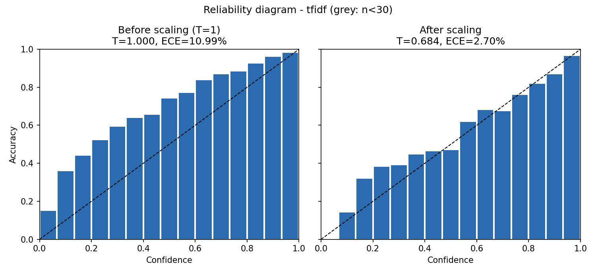
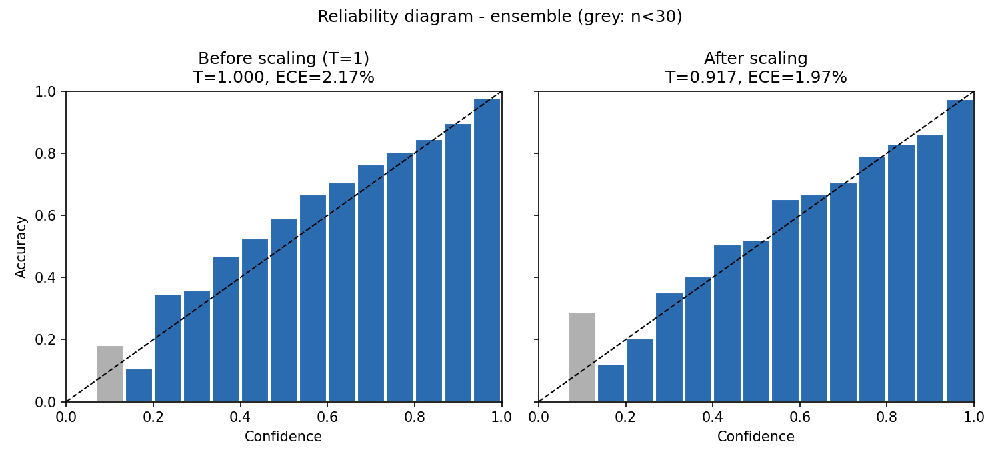
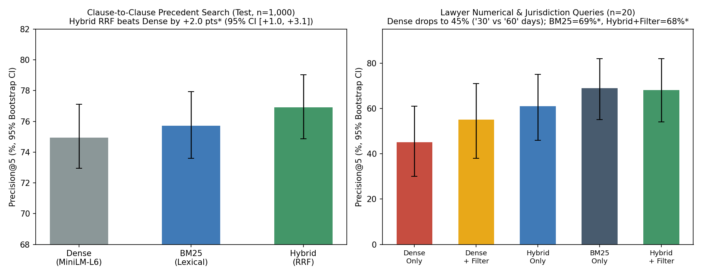
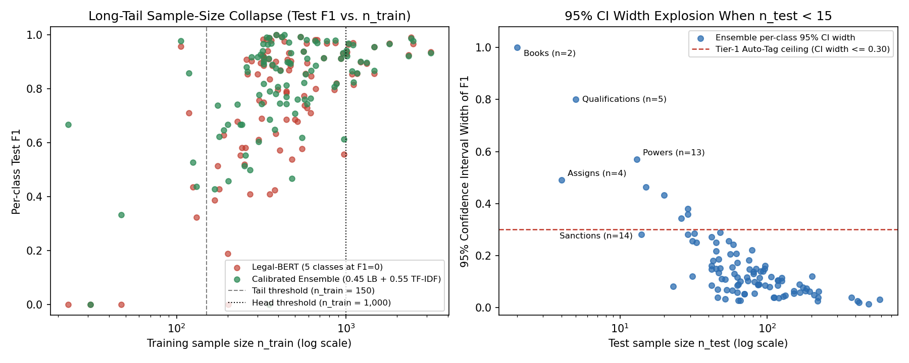
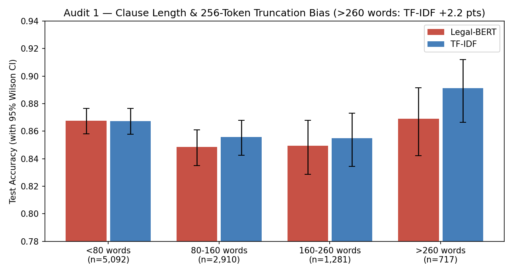
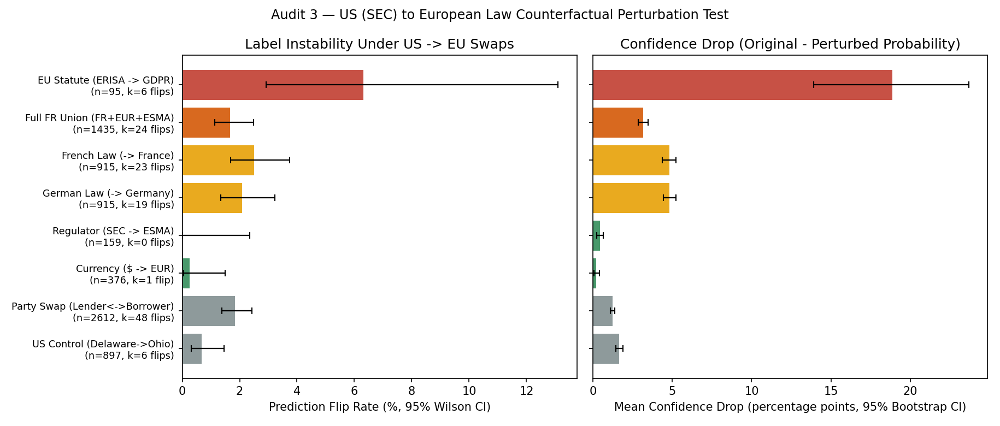

# Contract-Review Assistant — NLP Core, Hybrid Retrieval & Statistical Bias Audit

**Course:** MSA-DAT07-01 · Deep Learning for Sequential Data and NLP (Final Project)  
**Authors:** **Namie Pajot**, **Enzo Natali**, and **Guillaume RABEAU**

| Component | Shipped Method / Model | Primary Empirical Result (Test Set, $n = 10,000$) |
| :--- | :--- | :--- |
| **Clause Classification (100 classes)** | **Calibrated Soft-Voting Ensemble** ($0.45\text{ Legal-BERT} + 0.55\text{ TF-IDF}$) | **87.77% Accuracy** `[87.12%, 88.40%]` ($\chi^2 = 50.35, p < 10^{-11}$) · **80.62% Macro-F1** `[79.00%, 81.76%]` |
| **PEFT / Memory Ablation (3 epochs)** | **Legal-BERT + LoRA ($r = 8, \alpha = 16$)** on $W_Q, W_V$ (`371,812` trainable weights) | **0.34% weights (`295×` reduction, `224.9 MB`)** · **84.73% Accuracy** · **75.39% Macro-F1 (`99.3%` of full)** |
| **Probability Calibration** | **Temperature Scaling** ($T_{\text{LB}} = 0.964, T_{\text{TF}} = 0.684$) | Cuts `TF-IDF` Expected Calibration Error **4.1×** (`10.99%` $\rightarrow$ **`2.70%`**); Ensemble ECE = **`1.97%`** |
| **Human-in-the-Loop Triage** | **Split Conformal Prediction** ($\alpha = 0.05$) + **Tier-3 Guardrail** | **95.01% Marginal Coverage** · **69.44% Safe Auto-Tag at 96.60% Accuracy** (`27.30%` Shortlist, `3.26%` Escalation) |
| **Precedent Clause Retrieval (60k bank)** | **Hybrid Reciprocal Rank Fusion** (`MiniLM-L6-v2` + `BM25` + Type Filter) | **76.9% Precision@5** on $n=1,000$ clause search (`+2.0 pts` vs. Dense) · **68.0% Precision@5** on lawyer queries (`+23.0 pts`) |

---

## 1. Executive Summary

This repository implements, evaluates, and audits the **NLP core of a legal contract-review assistant** designed for corporate due diligence (M&A, credit agreements, commercial and supplier audits).

Given a contract clause or a lawyer's natural-language query, the system performs three core tasks:
1. **100-Class Clause Classification:** Assigns every contract clause to one of **100 legal clause types** (`Governing Laws`, `Terminations`, `Indemnifications`, `Confidentiality`, etc.) by combining a fine-tuned domain transformer (**Legal-BERT**) with a full-text lexical classifier (**TF-IDF + Logistic Regression**) in a **temperature-scaled soft-voting ensemble**, backed by a **3-epoch GPU LoRA ($r=8, \alpha=16$) ablation**.
2. **Precedent Clause Retrieval:** Searches a **60,000-clause precedent bank** using a **Hybrid Reciprocal Rank Fusion (RRF)** engine that fuses dense semantic embeddings (`sentence-transformers/all-MiniLM-L6-v2`), sparse lexical matching (`BM25`), and category pre-filtering.
3. **Statistical Uncertainty, Conformal Routing & Bias Auditing:** Rather than acting as a black box that reports single point estimates, every prediction and evaluation metric is backed by **95% Bootstrap or Wilson confidence intervals**, **McNemar's paired contingency tests**, **Split Conformal Prediction sets** for human-in-the-loop routing, and a **four-part failure-mode, party-role symmetry, and US-to-EU domain-shift audit**.

---

## 2. Dataset & Engineering Challenges

All experiments are conducted on the **LEDGAR** benchmark (`coastalcph/lex_glue`, configuration `ledgar`), extracted from public material contracts filed with the US Securities and Exchange Commission (SEC):
- **Strict Split Isolation:** `60,000` training clauses, `10,000` validation clauses, and `10,000` held-out test clauses across **100 clause categories** (`80,000` total clauses).
- **Extreme Zipfian Imbalance ($138\times$):** The most frequent category (`Governing Laws`) has **3,167** training clauses (`582` test), whereas the rarest (`Books`) has only **23** training clauses, **0** validation clauses, and **2** test clauses. Overall, **16 Head classes** ($n_{\text{train}} \ge 1,000$, `42.1%` of train / `41.7%` of test) coexist with **77 Medium classes** ($150 \le n_{\text{train}} < 1,000$, `57.0%` of train / `57.5%` of test) and **7 Tail classes** ($n_{\text{train}} < 150$, `0.97%` of train / `0.81%` of test).
- **US Training Data vs. European Deployment Context:** While the assistant targets a European legal-tech setting, LEDGAR consists entirely of English-language US Common Law contracts referencing US states (`Delaware`, `New York`), US regulators (`SEC`), and US federal statutes (`ERISA`, `Waiver Of Jury Trials`).

---

## 3. Repository Structure

```text
├── README.md                        # Project report, empirical tables, figures & Model Card
├── train_colab_pro.ipynb            # Executed GPU notebook (TF-IDF, Legal-BERT Full FT & 3-epoch LoRA)
├── pyproject.toml                   # Project metadata, dependencies & pytest configuration
├── requirements.txt                 # Pinned dependencies for standard pip installations
├── uv.lock                          # Deterministic lockfile for reproducible environments
├── presentation/
│   ├── deck.html                    # Self-contained interactive 1080p60 presentation player (40 stops)
│   ├── deck.mp4                     # Master 1080p60 rendered video of the presentation
│   └── presentation_script.md       # Synchronized speaker script (#0 to #39) & Jury Q&A reference
├── src/
│   ├── data.py                      # LEDGAR loader, class distribution & tokenizer fertility audit
│   ├── train.py                     # TF-IDF baseline + PyTorch GPU fine-tuning & LoRA (--lora)
│   ├── evaluation.py                # Bootstrap/Wilson 95% CIs, McNemar test, calibration & conformal sets
│   ├── retrieval.py                 # Hybrid retrieval engine (MiniLM-L6-v2 + SparseBM25 + RRF)
│   ├── retrieval_eval.py            # Protocol A: Clause-to-clause precedent retrieval benchmark (n=1,000)
│   ├── retrieval_lawyer_eval.py     # Protocol B: 20 lawyer constraint queries benchmark
│   └── bias_audit.py                # Long-tail, length truncation, taxonomy, party-role & US->EU audits
├── tests/
│   └── test_pipeline.py             # End-to-end automated unit & output consistency test suite
└── outputs/
    ├── class_distribution.csv       # Per-split sample counts across all 100 clause types
    ├── tokenizer_comparison.json    # Subword fertility & truncation rates (Legal-BERT, BERT, CamemBERT)
    ├── training_history.json        # 3-epoch Legal-BERT Full Fine-Tuning history & GPU wall time
    ├── lora_training_history.json   # 3-epoch Legal-BERT LoRA (r=8, alpha=16) history & bootstrap CIs
    ├── legal_bert_{val,test}_logits.npy  # Full Fine-Tuning validation & test logits (10,000 x 100)
    ├── lora_{val,test}_logits.npy        # LoRA (r=8, alpha=16) validation & test logits (10,000 x 100)
    ├── tfidf_{val,test}_logits.npy       # TF-IDF + Logistic Regression validation & test logits (10,000 x 100)
    ├── evaluation/                  # Global & per-class CIs, McNemar tests, reliability & forest plots
    ├── retrieval_eval/              # Retrieval benchmarks (CSV/JSON) & comparison plots
    └── bias_audit/                  # Long-tail, length, taxonomy & counterfactual audit outputs & plots
```

---

## 4. Methodology & Empirical Results

### 4.1 Subword Tokenization Audit, Transformer Architecture & LoRA Ablation (`src/data.py`, `src/train.py`)

Before fine-tuning, `src/data.py` audits three candidate tokenizers on `n = 2,000` sampled training clauses (`seed = 42`, `outputs/tokenizer_comparison.json`):

| Pretrained Model | Subword Algorithm & Pretraining Domain | Mean Tokens / Word | Median Clause Length | Clauses Truncated at 256 Tokens | Clauses Truncated at 512 Tokens |
| :--- | :--- | :---: | :---: | :---: | :---: |
| **`nlpaueb/legal-bert-base-uncased`** | WordPiece (`##`, 30,522 vocab) — US & EU Legal Text | **1.200** | **105.0** | **12.2%** | **1.6%** |
| `bert-base-uncased` | WordPiece (`##`, 30,522 vocab) — English Wikipedia/Books | 1.257 | 109.5 | 13.8% | 1.6% |
| `camembert-base` | SentencePiece Unigram (`▁`, 32,005 vocab) — French Oscar | 1.924 | 169.0 | 28.4% | 7.2% |

- **Why `AutoTokenizer` Alignment Matters:** Because `camembert-base` is trained on French, its SentencePiece Unigram vocabulary over-fragments English legal terminology by **+60%** (`1.924` vs. `1.200` subwords per word), causing **28.4%** of clauses to be truncated at our 256-token window. Even against general English `bert-base-uncased` (`1.257` tokens/word, e.g. `indemnification` $\rightarrow$ `ind`, `##em`, `##ni`, `##fication`), domain-specific `legal-bert-base-uncased` keeps legal compounds intact (`1.200` tokens/word) and cuts 256-token truncation from `13.8%` to `12.2%`.
- **Dynamic Batch Padding (`DataCollatorWithPadding`):** Rather than padding every clause statically to `max_length = 256`, batches are padded dynamically to the longest sequence in the mini-batch with binary `attention_mask` ($\text{score}_{ij} = -\infty \implies \text{softmax} = 0$ on `[PAD]` positions).
- **Full Fine-Tuning Protocol (`outputs/training_history.json`):** We fine-tune `nlpaueb/legal-bert-base-uncased` for **3 epochs** (`batch_size = 64`, `938` steps/epoch, `2,814` total steps, `AdamW` with $\text{lr} = 3\times 10^{-5}$, weight decay $0.01$, 10% linear warmup = `281` steps + cosine decay, `fp16` mixed precision, gradient clipping `1.0`). Total training time across 3 passes over the 60,000 clauses is **2,456.1s (~41 min on one GPU)**, with validation accuracy progressing `82.69% -> 85.37% -> 86.12%` (val loss `0.6722 -> 0.5467 -> 0.5220`), alongside a full-text **`TF-IDF + Logistic Regression`** baseline (`50,000` unigram/bigram features, `sublinear_tf=True`, `min_df=2`, `C=2.0`, trained in `19.2s`).
- **Parameter & GPU Memory Accounting + Empirical 3-Epoch LoRA Ablation (`src/train.py --lora`, `outputs/lora_training_history.json`):**
  - `Legal-BERT` totals **109,559,140 parameters**: Embeddings = `23.84M` (`21.8%`), 12 Transformer Encoder blocks = `85.05M` (`77.6%`, with `1/3` in Multi-Head Self-Attention `2.36M`/layer and `2/3` in Position-Wise FFN `4.72M`/layer), and the 100-class linear head = `76.9K` (`0.07%`).
  - Under standard `fp32` `AdamW` training (**16 bytes/parameter**: 4B weight + 4B gradient + 4B first moment $m$ + 4B second moment $v$), model states alone require **1.75 GB** before counting $O(B \cdot T^2)$ self-attention activations.
  - We also trained a **3-epoch `LoRALinear` ablation** ($h = Wx + \frac{\alpha}{r}BAx$ with $A \sim \mathcal{N}(0, 0.02^2)$ and $B = 0$ on all 12 layers' $W_Q, W_V$ projections + classification head, $r=8, \alpha=16, \text{lr}=8\times 10^{-4}$):

| Training Regime (3 Epochs on 60,000 Clauses) | Trainable Weights | State Memory (Weights + Grads + AdamW) | Wall Time (3 Epochs) | Validation Accuracy (Ep 1 $\rightarrow$ 2 $\rightarrow$ 3) | Held-Out Test Accuracy ($n=10,000$) | Held-Out Test Macro-F1 (100 Classes) |
| :--- | :---: | :---: | :---: | :---: | :---: | :---: |
| **Legal-BERT Full Fine-Tuning** | `109,482,240` (`100%`) | `1,751.7 MB` (**1.75 GB**) | `2,456.1s` (41.0 min) | `82.69% -> 85.37% -> 86.12%` | **85.98%** `[85.29%, 86.66%]` | **75.89%** `[74.81%, 77.11%]` |
| **Legal-BERT + LoRA ($r=8, \alpha=16$)** | **`371,812` (`0.34%`, `295×` less)** | **`224.9 MB` (`7.8×` less)** | **`491.4s` (8.2 min)** | `81.25% -> 83.85% -> 84.93%` | **84.73%** `[83.97%, 85.42%]` | **75.39%** `[73.86%, 76.47%]` (**`99.3%` of full**) |

  - Training only **0.34% of weights** with LoRA recovers **99.3% of Full Fine-Tuning's Macro-F1** (`75.39%` vs. `75.89%`) and **98.5% of its Accuracy** (`84.73%` vs. `85.98%`) with zero inference latency overhead (`merge_weights()` folds $\Delta W = \frac{\alpha}{r}BA$ back into $W$). Because Full Fine-Tuning retains a `+1.25 pt` accuracy edge, we use the Full Fine-Tuning logits in our production Ensemble.

---

### 4.2 Classification Performance, Paired Bootstrap & McNemar Tests (`src/evaluation.py`)

All global metrics on the `10,000`-clause test set are computed with **2,000 non-parametric bootstrap resamples** (`seed = 42`, `outputs/evaluation/summary.json`, `outputs/lora_training_history.json`):

| Model | Accuracy / Micro-F1 (95% CI) | Macro-F1 (95% CI) | Weighted-F1 (95% CI) | Top-3 Accuracy (95% CI) | Reliability Tiers (T1 / T2 / T3) |
| :--- | :---: | :---: | :---: | :---: | :---: |
| **Legal-BERT (LoRA $r=8, \alpha=16$, 372k params)** | 84.73% `[83.97%, 85.42%]` | 75.39% `[73.86%, 76.47%]` | 83.70% `[82.86%, 84.44%]` | 96.03% `[95.63%, 96.41%]` | `47 / 27 / 26` |
| **Legal-BERT (Full Fine-Tuned, 109.5M params)** | 85.98% `[85.29%, 86.66%]` | 75.89% `[74.81%, 77.11%]` | 85.06% `[84.31%, 85.79%]` | 95.92% `[95.51%, 96.31%]` | `51 / 24 / 25` |
| **TF-IDF + Logistic Regression** | 86.41% `[85.71%, 87.08%]` | 79.69% `[78.37%, 80.68%]` | 85.73% `[84.95%, 86.44%]` | 96.16% `[95.77%, 96.54%]` | `44 / 41 / 15` |
| **Calibrated Ensemble ($0.45\text{ LB} + 0.55\text{ TF}$)** | **87.77%** `[87.12%, 88.40%]` | **80.62%** `[79.00%, 81.76%]` | **87.04%** `[86.30%, 87.71%]` | **96.61%** `[96.25%, 96.96%]` | **`52 / 33 / 15`** |

- **Paired Bootstrap & McNemar's Contingency Test:**
  - **`Legal-BERT` vs. `TF-IDF`:** On Accuracy/Micro-F1, the difference is `-0.43 pts` `[-0.97%, +0.12%]` (not statistically significant). McNemar's $2\times 2$ contingency table reveals why ensembling is so effective: $a = 8,228$ clauses are solved by both, **$b = 370$ are solved only by Legal-BERT** (semantic paraphrases), **$c = 413$ are solved only by TF-IDF** (rare statutory n-grams and long clauses), and $d = 989$ are missed by both ($\chi^2 = \frac{(|370-413|-1)^2}{370+413} = 2.25 < 3.84$, $p = 0.133$). Those **783 complementary disagreements (`7.8%` of the test set)** allow the soft-voting ensemble to outperform both models.
  - **`Ensemble` vs. `Legal-BERT`:** Statistically significant gains of **+1.79 pts on Accuracy** `[+1.38%, +2.21%]` (McNemar $b=307$ vs. $c=128$, $\chi^2 = 72.84$, $p = 1.41 \times 10^{-17}$) and **+4.73 pts on Macro-F1** `[+3.38%, +5.67%]`.
  - **`Ensemble` vs. `TF-IDF`:** Statistically significant gain of **+1.36 pts on Accuracy** `[+0.99%, +1.73%]` (McNemar $b=249$ vs. $c=113$, $\chi^2 = 50.35$, $p = 1.29 \times 10^{-12}$) and **+1.30 pts on Weighted-F1** `[+0.92%, +1.70%]`. On **Macro-F1**, the **+0.94 pt gain** `[-0.08%, +1.75%]` slightly crosses zero due to high bootstrap variance on ultra-rare classes and is reported transparently as statistically non-significant.

---

### 4.3 Probability Calibration & Split Conformal Routing (`src/evaluation.py`)

To ensure predicted probabilities reflect true empirical accuracy before routing clauses to humans:

1. **Temperature Scaling on Validation ($p_i = \text{softmax}(z / T)_i$):**
   - Raw `TF-IDF + Logistic Regression` probabilities are severely **under-confident** (**ECE = 10.99%** `[10.36%, 11.61%]`, NLL = `0.618`; e.g., in the `0.63` confidence bin, empirical accuracy is already `84.0%`). Fitting a single temperature $T = 0.684 < 1$ on validation sharpens its distribution and cuts test ECE **4.1× to 2.70%** `[2.33%, 3.36%]` ($\Delta\text{ECE} = -8.29\text{ pts}$, statistically significant).
   - `Legal-BERT` is already well-calibrated before scaling (**ECE = 1.26%** `[1.02%, 1.98%]`; after $T=0.964$, ECE = **1.74%**, $\Delta = +0.48\text{ pts}$, non-significant), and the `Calibrated Ensemble` goes from **2.17%** to **1.97%** ($T=0.917$, $\Delta = -0.20\text{ pts}$, non-significant).

<p align="center">
  
  
</p>

2. **Split Conformal Prediction ($\alpha = 0.05$) — Adaptive Set Sizes Like Top-$p$ Nucleus Sampling:**
   - Just as Top-$p$ nucleus sampling adapts candidate set size dynamically vs. fixed Top-$k$, Split Conformal Prediction uses validation non-conformity scores $s_i = 1 - \hat{p}(y_i \mid x_i)$ to calibrate $\hat{q}_{0.95} = 0.9477$ and outputs variable-size sets $C(x) = \{y : \hat{p}(y \mid x) \ge 1 - \hat{q}_{0.95}\}$:
   - **Marginal Test Coverage:** **95.01%** `[94.56%, 95.43%]` (mean set size **1.43 labels**). Note that split conformal guarantees **marginal coverage** ($\mathbb{P}(Y \in C(X)) \ge 1 - \alpha$ on average), not class-conditional coverage on rare classes.
   - **Pure Conformal Routing:**
     - **Green — Auto-Tag (`|C(x)| = 1`):** **69.98%** `[69.01%, 70.87%]` of test clauses, with **96.57%** empirical accuracy (implying `3.43%` residual error on auto-tagged clauses = **~24 silent errors per 1,000 total clauses**, down from `122` without routing).
     - **Amber — Paralegal Shortlist (`|C(x)| \in \{2, 3\}`):** **27.30%** `[26.47%, 28.23%]` of clauses.
     - **Red — Senior Lawyer Escalation (`|C(x)| \ge 4`):** **2.72%** `[2.40%, 3.03%]` of clauses.
3. **Per-Class Reliability Tiers & Tier-3 Singleton Gate (`src/evaluation.py`):**
   - Using the 95% F1 confidence interval lower bound ($\text{CI}_{\text{lower}}$), CI width ($\le 0.30$), and minimum test support ($n_{\text{test}} \ge 10$), the Ensemble partitions the 100 classes into **52 Tier 1 (Green)**, **33 Tier 2 (Amber)**, and **15 Tier 3 (Red, Do Not Deploy)** classes.
   - Enforcing the **Tier-3 Guardrail** in `conformal_prediction_sets()` diverts the **54 Tier-3 singletons (`0.54%` of test clauses)** from Auto-Tag to Senior Escalation, yielding **69.44% Tier-Gated Auto-Tag** at **96.60% accuracy** and **3.26% Escalation**.

---

### 4.4 Hybrid Precedent Retrieval (`src/retrieval.py`, `src/retrieval_eval.py`, `src/retrieval_lawyer_eval.py`)

`ClauseBankRetriever` indexes all `60,000` training clauses using dense embeddings (`sentence-transformers/all-MiniLM-L6-v2`) and sparse lexical scores (`SparseBM25`), combined via **Reciprocal Rank Fusion (RRF, $k=60$)** and optional category pre-filtering (`outputs/retrieval_eval/`):

<p align="center">
  
</p>

- **Protocol A — Clause-to-Clause Precedent Search ($n=1,000$ test queries vs. 60,000-clause bank):**
  - `Dense (MiniLM-L6-v2)`: Precision@5 = **74.9%** `[72.9%, 77.1%]`, MRR@5 = **85.6%** `[83.6%, 87.5%]`, HitRate@5 = **91.0%**.
  - `BM25 (Lexical)`: Precision@5 = **75.7%** `[73.6%, 77.9%]`, MRR@5 = **85.2%** `[83.1%, 87.2%]`, HitRate@5 = **90.4%**.
  - `Hybrid (RRF)`: Precision@5 = **76.9%** `[74.9%, 79.0%]`, MRR@5 = **85.7%** `[83.7%, 87.8%]`, HitRate@5 = **91.1%** — a statistically significant **+2.0 point** `[+1.0%, +3.1%]` paired bootstrap improvement over Pure Dense (and **+2.0 points** `[+0.9%, +3.1%]` on the `780` queries without exact boilerplate duplicates).
- **Protocol B — Lawyer Natural-Language Constraint Queries ($n=20$ queries with exact numerical/jurisdictional constraints, e.g., *"termination clauses with a 30-day notice period"*):**
  - `Pure Dense`: Precision@5 drops to **45.0%** `[30.0%, 61.0%]` (55% of returned top-5 clauses fail the constraint), even though its category-only Precision@5 is **81.0%**—proving that dense embeddings capture the topic (*termination*) but blur exact numbers (`30` vs. `60` days).
  - `Hybrid (RRF)`: Precision@5 rises to **61.0%** `[46.0%, 75.0%]` (**+16.0 pts** over Pure Dense).
  - `Hybrid + Category Filter (Shipped)`: Precision@5 reaches **68.0%** `[54.0%, 82.0%]` (**+23.0 pts** `[+14.0%, +31.0%]` over Pure Dense, MRR@5 = **88.3%**, HitRate@5 = **95.0%**), statistically tied with `BM25` (**69.0%**, paired difference `-1.0 pt` `[-12.0%, +10.0%]`). *Methodological note:* because Protocol B's automated relevance check verifies both the target category and a regex match on the number/state token, lexical matchers like BM25 enjoy a slight evaluation circularity advantage on exact token presence, whereas Hybrid + Filter preserves semantic recall on paraphrased clauses (Protocol A).

---

### 4.5 Four-Part Bias, Party-Role & Failure-Mode Audit (`src/bias_audit.py`)

1. **Long-Tail Sample-Size Bias (`long_tail_audit.json`):**
   - **Head classes** ($n_{\text{train}} \ge 1,000$, 16 classes, `41.7%` of test): `Legal-BERT` and `Ensemble` achieve **92.0%** and **92.2%** mean F1 with a narrow **5.1-point** mean 95% CI width.
   - **Medium classes** ($150 \le n_{\text{train}} < 1,000$, 77 classes, `57.5%` of test): `Legal-BERT` achieves **76.3%** mean F1 (scoring `0.0%` on 2 medium classes—`Applicable Laws` $n_{\text{train}}=352$ and `Jurisdictions` $n_{\text{train}}=202$—due to absorbing taxonomy overlap with `Governing Laws` and `Venues`), whereas the `Ensemble` rises to **80.6%** mean F1 (mean CI width **14.1 pts**).
   - **Tail classes** ($n_{\text{train}} < 150$, 7 classes, `0.81%` of test): `Legal-BERT` drops to **34.6%** mean F1 (scoring `0.0%` on 3 tail classes: `Books`, `Assigns`, `Qualifications`), whereas the `Ensemble` recovers to **54.3%** mean F1 (**+19.7 pts**). However, the mean 95% CI width on Tail classes explodes to **52.2 points** (e.g., `Books` $n_{\text{test}}=2$ has Wilson CI `[34.2%, 100%]`, width `65.8 pts`), proving that rare classes cannot be statistically certified without larger test support.

<p align="center">
  
</p>

2. **Clause Length & 256-Token Truncation Audit (`length_audit.json`):**
   - Across `<80` words ($n=5,092$), `80–160` words ($n=2,910$), `160–260` words ($n=1,281$), and `>260` words ($n=717$), `Legal-BERT` achieves `86.8%`, `84.8%`, `84.9%`, and `86.9%` `[84.2%, 89.2%]`. On `>260` words, full-text `TF-IDF` reaches `89.1%` `[86.6%, 91.2%]` (+2.23 pts point estimate, though the 95% Wilson CIs overlap), and the `Calibrated Ensemble` reaches **89.8%** `[87.4%, 91.8%]`.

<p align="center">
  
</p>

3. **Taxonomy Overlap vs. Compound Clauses (`taxonomy_audit.json`):**
   - Just **10 confusion pairs** out of 4,950 possible pairs account for **25.5% of all Legal-BERT errors** (`357 / 1,402` errors). Most are **LEDGAR label near-synonyms** resulting from heterogeneous SEC contract headings (`Tax Withholdings` $\leftrightarrow$ `Withholdings`: 60 errors; `Applicable Laws` $\rightarrow$ `Governing Laws`: 42 unidirectional errors; `Defined Terms` $\leftrightarrow$ `Definitions`: 41; `Entire Agreements` $\leftrightarrow$ `Integration`: 30; `Amendments` $\leftrightarrow$ `Modifications`: 29). The `Ensemble` reduces total errors from `1,402` to `1,223` (`23.4%` in top 10 pairs), and conformal shortlists surface both synonymous labels together.
4. **Counterfactual Perturbation Audit — US $\rightarrow$ EU Domain Shift & Party-Role Symmetry (`counterfactual_audit.json`):**
   - Executed on the full-text lexical classifier (`TF-IDF`, `99.77%` agreement with saved test predictions) paired with multi-model baseline cohorts across all 3 models:
     - **US State Control (`Delaware` $\rightarrow$ `Ohio`, $n=897$):** **0.67%** flip rate `[0.31%, 1.45%]` (baseline lexical sensitivity).
     - **Contractual Party-Role Symmetry (`Lender` $\leftrightarrow$ `Borrower`, `Employer` $\leftrightarrow$ `Employee`, `Landlord` $\leftrightarrow$ `Tenant`, `Licensor` $\leftrightarrow$ `Licensee`, $n=2,612$, `26.1%` of test clauses):** **1.84%** flip rate `[1.39%, 2.43%]`, accuracy `86.4% -> 85.8%`, confidence drop `+1.22 pts` `[+1.09, +1.36]`, confirming strong party-role symmetry across bilateral commercial contracts.
     - **Currency (`$` $\rightarrow$ `EUR`, $n=376$) & Regulator (`SEC` $\rightarrow$ `ESMA`, $n=159$):** **0.27%** `[0.05%, 1.50%]` and **0.00%** `[0.00%, 2.35%]` flip rates (invariant).
     - **European Jurisdictions (US state $\rightarrow$ `Germany` / `France`, $n=915$):** Flip rate rises **3.1×–3.8×** above the US control to **2.08%** `[1.33%, 3.22%]` (Germany) and **2.51%** `[1.68%, 3.74%]` (France), with a **+4.80 pt** confidence drop `[+4.37, +5.22]`.
     - **European Statute (`ERISA` $\rightarrow$ `GDPR`, $n=95$):** Flip rate jumps to **6.32%** `[2.93%, 13.10%]` overall (**10.91%** `[5.10%, 21.83%]` on true `Erisa` clauses) with a **+18.87 percentage-point drop in confidence** `[+13.92, +23.71]`, because `GDPR` is out-of-vocabulary in US SEC filings.

<p align="center">
  
</p>

---

## 5. Model Card & Deployment Boundaries

### 5.1 Model Card Summary
- **Model Architecture:** Calibrated Soft-Voting Ensemble ($0.45 \times \text{Legal-BERT}_{\text{base}} (T=0.964) + 0.55 \times \text{TF-IDF}_{\text{50k, (1,2)-gram}} (T=0.684)$) + Split Conformal Predictor ($\alpha = 0.05, \hat{q} = 0.9477$) + Hybrid RRF Clause Retriever (`all-MiniLM-L6-v2` + `SparseBM25`).
- **Intended Use:** High-throughput first-pass clause triage and precedent lookup on English-language corporate and commercial contracts (M&A, credit agreements, employment/executive agreements, licensing) with mandatory human-in-the-loop review on conformal sets $|C(x)| \ge 2$ and Tier-2/Tier-3 categories.
- **Out-of-Scope / Prohibited Use:** Fully autonomous legal sign-off without human review; deployment on French/German Civil Law contracts or EU statutory clauses (`GDPR`, `Works Council`, `ESMA`) without domain adaptation; standalone autonomous tagging on the 15 Tier-3 clause categories.

### 5.2 Six Enforced Production Guardrails

| # | Prohibited Use Case | Empirical Evidence from Our Audit | Enforced Product Guardrail |
| :--- | :--- | :--- | :--- |
| **1** | **Autonomous tagging of the 15 Tier-3 (Red) clause types** | 15 classes have $\text{CI}_{\text{lower}} < 50\%$ (e.g., `Assigns` CI `[0%, 49%]`, `Applicable Laws` F1 `0.0%`). | Hard-block auto-tagging on all 15 Tier-3 classes (`54` singletons diverted to escalation; **69.44%** Tier-Gated Auto-Tag at **96.60%** accuracy). |
| **2** | **Forcing a single label on overlapping LEDGAR synonyms** | Top 10 near-synonym pairs drive **25.5%** of `Legal-BERT` errors (`Tax Withholdings`/`Withholdings`, `Defined Terms`/`Definitions`). | Use 95% Split Conformal sets: route size 2–3 (**27.30%**) to a paralegal shortlist and size $\ge 4$ (**2.72%**) to a senior lawyer, and merge synonymous labels in taxonomy V2. |
| **3** | **Standalone `Legal-BERT` without lexical ensemble** | McNemar's test shows `783` complementary disagreements (`370` LB-only vs. `413` TF-IDF-only); `Legal-BERT` loses **-3.80 pts** in Macro-F1 vs. `TF-IDF`. | Deploy the calibrated `Legal-BERT + TF-IDF` ensemble (**87.77%** accuracy, $p < 10^{-11}$, **80.62%** Macro-F1). |
| **4** | **Pure dense vector search on numerical/jurisdictional queries** | Dense-only Precision@5 falls to **45.0%** on lawyer queries (*"30-day notice"* vs. *"60-day notice"*). | Enforce **Hybrid RRF (Dense + BM25) + Category Filter** (**68.0%** Precision@5 on lawyer queries, **76.9%** on $n=1,000$ precedent search). |
| **5** | **Unadapted deployment on European Civil Law or EU statutes (`GDPR`)** | Swapping `ERISA` $\rightarrow$ `GDPR` flips **6.32%** of predictions and drops confidence by **18.87 pts**; US states $\rightarrow$ `France` increases flips **3.8×**. | Restrict to English US-style corporate contracts until fine-tuned and recalibrated on annotated EU clauses. |
| **6** | **Treating marginal conformal coverage as zero-error or per-class guarantee** | **95.01%** conformal coverage is marginal, and Auto-Tag (`96.57%` accuracy) leaves **~24 silent errors per 1,000 clauses**. | Present the assistant strictly as a triage tool with continuous audit sampling on auto-tagged clauses; final legal interpretation remains with a qualified lawyer. |

---

## 6. Installation & Reproducibility

### Using `uv` (recommended)

```bash
uv sync

# 1. Run automated unit & integration test suite (8/8 tests)
uv run pytest -v

# 2. Statistical evaluation, McNemar test, calibration, ensemble & conformal prediction sets
uv run python -m src.evaluation

# 3. Precedent retrieval benchmarks (Protocol A: clause-to-clause, Protocol B: lawyer queries)
uv run python -m src.retrieval_eval --split test --final
uv run python -m src.retrieval_lawyer_eval

# 4. Full bias, party-role & failure-mode audit + plots
uv run python -m src.bias_audit --audit all
```

### Using `pip` / `.venv`

```bash
python3 -m venv .venv
source .venv/bin/activate
pip install -r requirements.txt
pytest -v
python -m src.evaluation
python -m src.retrieval_lawyer_eval
python -m src.bias_audit --audit all
```

---

## 7. Presentation Deck & Speaker Script

The defence presentation and its synchronized step-by-step speaker script (`#0` to `#39`) are located in [`presentation/`](presentation/):
1. [`presentation/deck.html`](presentation/deck.html) (with [`presentation/deck.mp4`](presentation/deck.mp4)): Self-contained 1080p60 animated presentation deck (`Space` / `→` to advance, `←` to go back, `F` for fullscreen, `R` to reset).
2. [`presentation/presentation_script.md`](presentation/presentation_script.md): Step-by-step spoken script synchronized to every `[PRESS →]` stop (`#0`–`#39`), plus a Jury Q&A quick-reference table.
